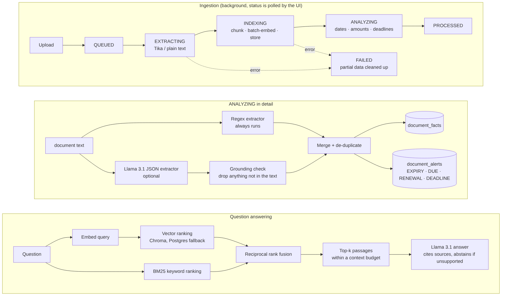

# 🔐 DocLock 3.0 — Personal Document Intelligence

A self-hosted, private RAG system that stores your personal documents (insurance, rent agreements, fee circulars, notes), **understands them**, and **warns you before they expire**. Everything runs locally: Llama 3.1 8B and Nomic embeddings via Ollama, ChromaDB, PostgreSQL, Apache Tika, a FastAPI backend and a React frontend.


> **About the GIF:** it predates the 3.1 features (answer check, privacy scan, calendar export, insights tab). It is a real recording of the real web UI (upload → background progress → deadline alerts → extracted facts → cited answer), but it was recorded against a *stubbed test backend* (fake embeddings and LLM), so the answer text is canned. Re-record it on your own stack with `python docs/record_demo.py --password "<your password>"`.

## What's new in 3.0

| Area | What it does |
|---|---|
| **Document intelligence** | Dates, amounts and deadlines are extracted (regex + LLM JSON), *grounded against the document text* (invented values are dropped), stored in `document_facts`, and turned into expiry alerts in `document_alerts` (OVERDUE / DUE_SOON / UPCOMING). |
| **Async ingestion** | Upload returns `202` immediately; a background task runs `QUEUED → EXTRACTING → INDEXING → ANALYZING → PROCESSED / FAILED`. The UI polls and shows a progress bar. Documents stuck by a restart are marked FAILED on startup. |
| **Hybrid retrieval** | Vector (Chroma, Postgres cosine fallback) + BM25 keywords fused with reciprocal rank fusion. Degrades to BM25 if embeddings are unavailable. Selectable per question in the UI. |
| **Modular backend** | `main.py` split into `routers/`, `services/`, `models`, `schemas`, `security`, `config`. |
| **Answer trust check** | Every number and date in an LLM answer is checked against the passages it was given. The UI shows *“3 of 4 figures verified”* and names the figures it could not find, so a wrong “48 months” (source says 24) is caught instead of trusted. Deterministic, no second LLM call. |
| **Privacy scan (India-specific)** | Detects Aadhaar (Verhoeff checksum, so random 12-digit numbers are ignored), PAN, GSTIN, IFSC, mobile and email. Findings are computed on demand and returned **masked only** (`XXXX XXXX 9012`); a vault-wide privacy report and a redacted copy of any document are available. |
| **Document type + checklist** | Rule-based classifier (insurance, rental, fee circular, warranty, ...) that explains its decision, plus a checklist of clauses that should be present (waiting period? exclusions? notice period?) and flags the ones not found. |
| **Calendar export** | One click exports open deadlines as `.ics` (all-day events, reminders 7 days and 1 day before, stable IDs so re-import updates instead of duplicating). |
| **Tests** | 148 pytest tests (chunking, ranking, retrieval, facts, auth, API) using SQLite and fakes for Ollama/Chroma/Tika. |
| **Evaluation** | 28 questions over 4 documents, retrieval hit@k / MRR, answer-correctness check, refusal check, plus a chunk-size experiment. |
| **Security** | PBKDF2-SHA256 password hashes, constant-time checks, JWT, login rate limiting, CORS allow-list, upload validation, SHA-256 duplicate detection. |

## Architecture




## Quick start

Requirements: Docker Desktop, [Ollama](https://ollama.com) on the host.

```bash
ollama pull llama3.1:8b
ollama pull nomic-embed-text

cp .env.example .env          # then edit it
docker compose up --build
```

Open http://localhost:3000.

**Choose a password.** `DOCLOCK_PASSWORD` accepts plain text or a PBKDF2 hash (recommended):

```bash
cd backend
python hash_password.py       # prompts twice, prints pbkdf2_sha256$310000$...
```

Paste the printed value into `.env` as `DOCLOCK_PASSWORD=...` (wrap it in single quotes if your shell/compose complains about `$`; in `docker-compose` files escape `$` as `$$`). Also set a long random `DOCLOCK_JWT_SECRET`.

Windows helpers: `start-doclock.ps1`, `STOP-DOCLOCK.ps1`, `test-doclock.ps1` (end-to-end smoke test: login → upload → wait for processing → facts → alert → chat), `verify-project.ps1`.

## Evaluation

All numbers below are **measured**, not estimated. Dataset: `eval/corpus` (4 documents) and `eval/questions.json` (24 answerable questions — direct and paraphrased — each with gold evidence text and accepted answer keywords, plus 4 unanswerable questions that should be refused).

### Design choice compared: chunk size (and overlap)

Offline experiment, BM25 retrieval, top-3, corpus-wide. A question is a hit when a retrieved passage comes from the right document and contains the gold evidence phrase. Reproduce: `python eval/offline_chunk_experiment.py`.

| chunk size | chunks | LLM context (chars) | hit@1 | hit@3 | MRR@3 | hit@3 direct | hit@3 paraphrase |
|---|---:|---:|---:|---:|---:|---:|---:|
| 200 | 71 | 457 | 50% | 62% | 0.56 | 92% | 27% |
| 300 | 49 | 668 | 50% | 67% | 0.58 | 100% | 27% |
| 500 | 27 | 1123 | 58% | 83% | 0.69 | 100% | 64% |
| 800 | 19 | 1711 | 67% | 92% | 0.78 | 100% | 82% |
| **1000 (default)** | 13 | 2346 | 75% | 96% | 0.83 | 100% | 91% |
| 1500 | 9 | 3267 | 88% | 96% | 0.92 | 100% | 91% |
| 3000 | 4 | 5495 | 100% | 100% | 1.00 | 100% | 100% |

Overlap at chunk size 500: 0 chars → 79% hit@3, 50 → 92%, 100 → 88%, 150 → 88%, 250 → 67%.

**Conclusion.** Very small chunks (≤300 characters) lose context and miss paraphrased questions. Larger chunks score higher, but the metric does not charge for their cost: at 3000 characters each document is one chunk, so "hit" only means BM25 chose the right document, and the model must read ~5,500 characters per question. **1000 characters with ~15% overlap** keeps 96% hit@3 at less than half that context, so it is the default. Heavy overlap (250 on 500) hurts because near-duplicate chunks crowd the top-3. With only 24 questions, one question ≈ 4 points, so differences under ~10 points are noise.

### Live evaluation: vector vs. keyword vs. hybrid, and answer correctness

These need your running Ollama stack, so I did not fabricate them. Run:

```bash
python eval/run_eval.py --base-url http://localhost:3000 --username admin --password "<your password>"
```

It uploads the corpus, waits for processing, then reports per strategy (`lexical`, `vector`, `hybrid`): hit@1, hit@k, MRR, paraphrase hit@k; and for generated answers: keyword-based correctness, grounding (answer cites a retrieved passage containing the evidence), refusal rate on the unanswerable questions, and latency. Results are written to `eval/results.md`. Paste them here:

| strategy | hit@1 | hit@3 | MRR@3 | paraphrase hit@3 |
|---|---:|---:|---:|---:|
| lexical (BM25) | _fill in_ | _fill in_ | _fill in_ | _fill in_ |
| vector | _fill in_ | _fill in_ | _fill in_ | _fill in_ |
| hybrid (RRF) | _fill in_ | _fill in_ | _fill in_ | _fill in_ |

| answer correctness | grounded | refusal on unanswerable | median latency |
|---:|---:|---:|---:|
| _fill in_ | _fill in_ | _fill in_ | _fill in_ |

*Answer correctness is a keyword proxy (the answer must contain an accepted keyword/number from the gold list). It is cheap and reproducible but can miss correct paraphrases and accept lucky matches.*

## Document intelligence (expiry alerts)

1. Regex finds dates (ISO, `15/03/2026` day-first, `15 March 2026`) and amounts (`Rs. 5,00,000`, `₹4,500`) and classifies dates as EXPIRY / RENEWAL / DUE / DEADLINE by the nearest keyword.
2. The LLM is asked for structured JSON facts. Each value must be found in the document text or it is discarded.
3. Facts are merged and stored in `document_facts`; date facts with deadlines create `document_alerts`.
4. The dashboard lists alerts by urgency (overdue / due within `DOCLOCK_ALERT_WINDOW_DAYS` / upcoming); alerts can be dismissed.

## API

| Method | Path | Purpose |
|---|---|---|
| POST | `/api/auth/login` | Get a JWT (rate-limited) |
| GET | `/api/auth/me` | Current user |
| POST | `/api/documents` | Upload (returns 202, processes in background) |
| GET | `/api/documents` | List with status and progress |
| GET | `/api/documents/{id}` · `/content` · `/facts` · `/view` · `/download` | Details, text, facts, preview, file |
| DELETE | `/api/documents/{id}` | Delete |
| POST | `/api/retrieve` | Retrieval only (mode: `lexical` / `vector` / `hybrid`) — used by the evaluation |
| POST | `/api/chat` | Grounded answer, cited passages, and `verification` (verified / partial / unverified) |
| GET | `/api/chat/conversations` · `/{id}/messages` | History |
| GET | `/api/alerts` | Alerts + summary (`includeAcknowledged`, `withinDays`) |
| PATCH | `/api/alerts/{id}` | Dismiss / restore (`{"acknowledged": true}`) |
| GET | `/api/documents/{id}/insights` | Document type, checklist, masked identifiers |
| GET | `/api/documents/{id}/redacted` | Extracted text with identifiers masked |
| GET | `/api/privacy` | Vault-wide privacy report (counts, masked) |
| GET | `/api/alerts/calendar.ics` | Deadlines as an iCalendar file |
| GET | `/actuator/health` | Health check |

## Tests

```bash
cd backend
pip install -r requirements-dev.txt
pytest
```

148 tests cover chunking boundaries, BM25/RRF ranking, the three retrieval modes and fallbacks, date/amount extraction and LLM-output grounding, alert statuses, auth (hashing, tokens, expiry, rate limiting), the upload → process → facts → chat API flow, the PII detector (including the Verhoeff checksum against its published worked example), document typing, answer verification, `.ics` output, and the shape of the evaluation dataset.

## Project structure

```
backend/app/        config, db, models, schemas, security, main
  routers/          auth, documents, chat, alerts, privacy
  services/         chunking, extraction, embeddings, vectorstore, retrieval, ranking, llm, facts, ingestion,
                    verify (answer check), pii (India identifiers), doctype (type + checklist), calendar_ics
backend/tests/      pytest suite
frontend/src/       React app (App.jsx, services/api.js)
samples/            synthetic_kyc.txt (fake Aadhaar/PAN/phone to try the privacy scan)
eval/               corpus, questions.json, offline_chunk_experiment.py, run_eval.py
docs/               architecture/pipeline diagrams (.mmd sources), demo.gif, record_demo.py
database/schema.sql PostgreSQL schema
docker-compose.yml  postgres, chroma, tika, backend, frontend
```

## Honest limitations

- **Single user.** One configured account; not multi-tenant.
- **Background tasks are in-process** (FastAPI `BackgroundTasks`). A restart interrupts running jobs (they are marked FAILED and can be re-uploaded); a real queue (Celery/RQ) is the production answer.
- **Extraction is heuristic.** Regex + LLM can miss or misclassify dates; the UI says "verify against the original". Scanned documents need OCR (not included).
- **Rate limiter is per client address and in memory.** Behind the bundled nginx every request shares one address, so a lockout is effectively global; use `X-Forwarded-For` handling or a shared store for production.
- **Answer check verifies figures, not meaning.** A correct number used for the wrong thing still passes; non-numeric claims are not checked.
- **PII detection is pattern-based.** Aadhaar uses a checksum; PAN/GSTIN/IFSC use their formats, so look-alikes can be flagged and unusual layouts missed. Names and addresses are not detected.
- **Evaluation is small** (24 + 4 questions) and answer correctness is a keyword proxy, not a human or LLM judge.
- Llama 3.1 8B can still err; answers always show their sources.

## Viva talking points

- Why hybrid retrieval: embeddings handle paraphrase, BM25 handles exact numbers and names; RRF needs no score calibration.
- Why ground LLM-extracted facts against the text: it turns a hallucination risk into a verifiable output.
- Why the chunk-size result is not "bigger is better": the metric ignores context cost; show the LLM-context column.
- Why a trust layer: small local models mis-state numbers; checking figures against the retrieved text is cheap, deterministic and measurable.
- Why a Verhoeff checksum for Aadhaar: it removes most false positives from plain 12-digit numbers without any ML.
- Why async ingestion: extraction + embedding + LLM analysis takes tens of seconds; the API stays responsive and the UI polls status.
- What you would do next: a task queue, OCR, multi-user isolation, an LLM judge for answer correctness, larger evaluation set.
