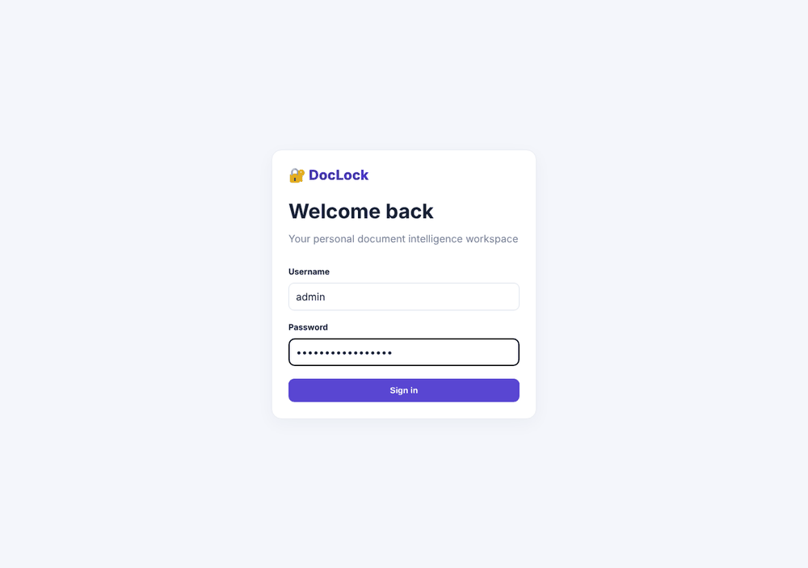
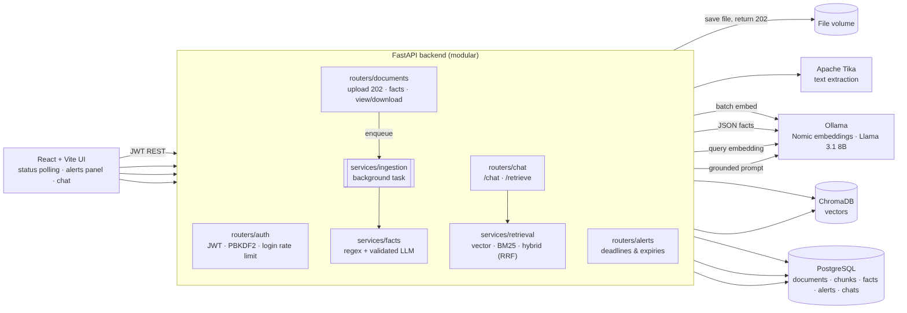

# 🔐 DocLock

**A private, self-hosted AI assistant for personal documents.** Upload insurance policies, rent agreements or fee circulars, then ask questions and get cited answers, deadline alerts and a privacy scan. Everything runs locally, so no document ever leaves your machine.


-purple)

<p align="center"></p>

## Problem

Important papers are long and full of dates and amounts people miss. Typical "chat with your PDF" tools send private data to the cloud, sometimes state wrong numbers confidently, and never warn you about expiring deadlines. DocLock addresses all three.

## Key Features

- **Answer trust check:** every number and date in the LLM's answer is verified against the retrieved passages (e.g. "3 of 4 figures verified"). It is deterministic and needs no second LLM call.
- **Deadline and expiry alerts:** extracts dates and amounts (regex + LLM, grounded against the document text so invented values are dropped), classifies them as Overdue / Due soon / Upcoming, and exports to calendar as `.ics`.
- **India-specific privacy scan:** detects Aadhaar (Verhoeff checksum validated), PAN, GSTIN, IFSC, mobile and email. Only masked values are returned, with a one-click redacted copy.
- **Hybrid retrieval:** vector search + BM25 fused with reciprocal rank fusion, with graceful fallback to keyword search if embeddings are down.
- **Document type + checklist:** classifies the document and flags missing clauses (waiting period, exclusions, notice period).
- **Automatic OCR:** scanned PDFs and images via Tesseract (English + Tamil); text pages skip OCR.
- **Async ingestion:** uploads return instantly while processing runs in the background with live progress.

## Tech Stack

| Layer | Technology |
|---|---|
| Frontend | React 18, Vite, Tailwind CSS |
| Backend | FastAPI, SQLAlchemy, JWT auth (PBKDF2-SHA256 hashing, login rate-limiting) |
| Data | PostgreSQL, ChromaDB (vectors) |
| AI / NLP | Ollama (Llama 3.1 8B, nomic-embed-text), BM25, RRF |
| Document processing | Apache Tika, PyMuPDF, Tesseract OCR |
| DevOps | Docker Compose (7 services) |

## Architecture

<p align="center"></p>

Upload → text extraction (Tika / PyMuPDF / OCR) → chunking → embeddings (Chroma) + fact extraction and privacy scan (Postgres) → hybrid retrieval → grounded LLM answer → numeric verification.

## Results

A chunk-size experiment on 24 questions over 4 documents (BM25, top-3) shaped the default configuration:

| Chunk size | hit@3 | Context sent to LLM |
|---|---:|---:|
| 500 | 83% | ~1,100 chars |
| **1000 (chosen)** | **96%** | ~2,300 chars |
| 3000 | 100% | ~5,500 chars |

The 3000-character setting scores highest only because each document becomes a single chunk, so 1000 gives 96% hit@3 at less than half the context cost. Reproduce with `python eval/offline_chunk_experiment.py`.

## Quick Start

Requires Docker Desktop (~10 GB disk, 8 GB+ RAM).

```bash
cp .env.example .env            # set the CHANGE_ME values
docker compose up --build -d
```

Open **http://localhost:3000** and log in with the credentials from `.env`. Sample files are in `eval/corpus/` and `samples/`.

## Project Structure

```
backend/app/   routers (auth, documents, chat, alerts, privacy) + services (retrieval, ranking, facts, verify, pii, ...)
frontend/src/  React app
eval/          benchmark corpus, questions, evaluation scripts
docs/          architecture diagrams, demo, screenshots
```

## Limitations and Roadmap

Single-user; ingestion uses in-process background tasks; extraction is heuristic, so important values should be checked against the original.
**Next:** task queue (Celery/RQ), multi-user isolation, LLM-as-judge evaluation, semantic claim checking.

---

Built by **Gangalakshmi Raja**
